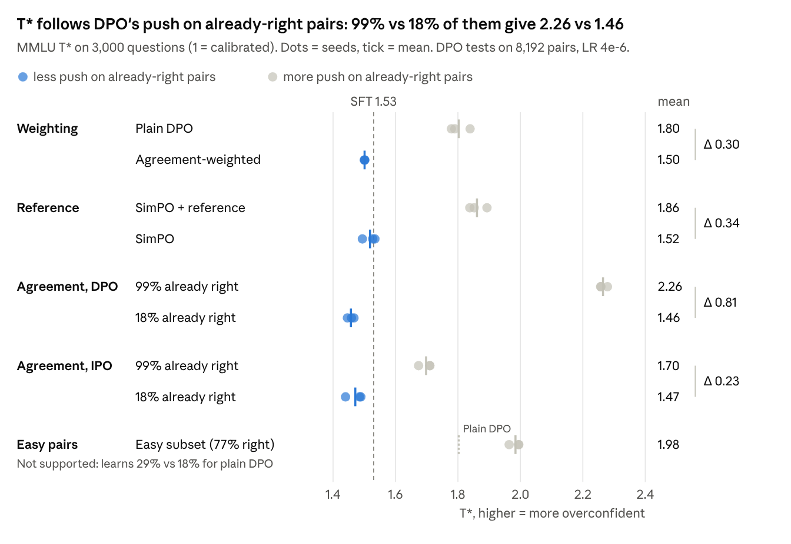
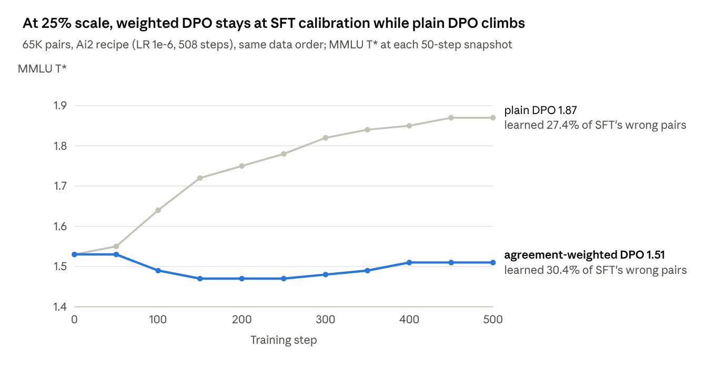

# Why DPO makes Olmo 3 overconfident

<!-- DRAFT SUMMARY: rewrite in your own words -->
Olmo 3 7B's Instruct DPO stage is the largest single source of the model's overconfidence on multiple-choice
questions: it raises the temperature needed to recalibrate the model (T*) from 1.52 to 2.34 while leaving its answers,
accuracy and ranking of right vs wrong answers unchanged. This project traces that to which preference pairs DPO
trains on. About two thirds of Olmo 3's pairs are ones the SFT model already gets right, and because DPO measures
progress against the SFT model, those pairs get the same weight as the ones it gets wrong; training on them sharpens
the model's existing answer machinery. In pre-registered small-scale tests, training sets with 99% vs 18%
already-right pairs give T* 2.26 vs 1.46, and adding DPO's reference model to the reference-free SimPO objective
brings all of the overconfidence back. Down-weighting the already-right pairs keeps SFT's calibration on 25% of Ai2's
DPO data, but on the full data it removes only about 60% of the rise and makes responses much longer, so it is a test
of the explanation rather than a recipe change.
<!-- END DRAFT -->

**Write-up:** [writeup/why-dpo-makes-olmo3-overconfident.pdf](writeup/why-dpo-makes-olmo3-overconfident.pdf)
(16 pages; definitions, all results, mechanism, limits).

## Headline results

MMLU T* (1 = calibrated, higher = more overconfident). Accuracy and AUROC are flat in every run.

| Setting | SFT | Plain DPO | Agreement-weighted DPO |
| --- | --- | --- | --- |
| Small tests: 8K pairs, LR 4e-6, 3 seeds (3,000-question subset) | 1.53 | 1.80 | 1.50 |
| 25% of Ai2's DPO data, Ai2's recipe (our plain rerun as baseline) | 1.52 | 1.85 | 1.50 |
| All ~260K pairs, Ai2's recipe (Ai2's released DPO model as baseline) | 1.52 | 2.34 | 1.80 |

At full scale the weighted model's chat responses are 2.4x as long as SFT's, and an LLM judge prefers SFT's answers
(40% win rate; 50% after adjusting for length; released DPO 55%).

## Pre-registration

Predictions with numeric thresholds were written down before the runs they cover, in
[olmo-calib/why_tests/](olmo-calib/why_tests/); results are in
[olmo-calib/why_tests/WHY_RESULTS.md](olmo-calib/why_tests/WHY_RESULTS.md).

| File | Covers | Evidence it came first |
| --- | --- | --- |
| `PREDICTIONS.md` | 27-run wave (predictions 1-5, stop rule) | SHA-256 and write time recorded in `PREDICTIONS.sha256` (2026-10-13 07:32 UTC, before the wave started). It was committed to git together with its results, so git does not independently show the order. |
| `PREDICTIONS_ADDENDUM_1.md` | Weighting on a 99%-agreed set (prediction 6) | Committed before any of its runs finished. |
| `PREDICTIONS_ADDENDUM_2.md` | Weighting on a 100%-agreed set (prediction 7) | Committed before any of its runs started. Stopped after seed 1 by choice; reported as a deviation. |

Git commit times are self-reported, so treat them as a record, not proof. Outcomes, including the failures:

| Prediction | Outcome |
| --- | --- |
| 1. Agreement weighting lowers T* at little cost in learning | Confirmed (1.80 → 1.50; 1.4 points less learning) |
| 2. 99% vs 18% already-right pairs, matched on source and length | Confirmed (2.26 vs 1.46, every seed) |
| 3a. SimPO (no reference) below plain DPO | Confirmed (1.52; learns more) |
| 3b. Adding the reference to SimPO restores the overconfidence | Confirmed (1.86, all of plain's excess) |
| 4. "Easy" pairs more overconfident at matched learning | Not supported (they also learn far more) |
| 5. IPO lowers T*, but agreement still matters | Confirmed (1.70 vs 1.47) |
| 6a / 7b. Weighting helps on almost or fully agreed data | Not supported (2.26 → 2.19; 2.32 → 2.24, one seed) |
| 6b / 7a / 7c. No overshoot; dropping the few disagreed pairs changes little | Confirmed |

## Repository map

Everything lives in [olmo-calib/](olmo-calib/) (the scripts expect that folder name).

| Path | What it is |
| --- | --- |
| `calib_eval.py`, `temp_scaling.py`, `format_check.py`, `cot_test.py` | Stage-by-stage calibration of the released checkpoints, formats, chat and self-consistency |
| `eval_ckpt.py` | Unified evals for a trained checkpoint: letters, chat, cloze, IFEval, held-out pairs, generations, BigBenchHard |
| `why.py` | Mechanism probes: direct attribution, normalization split, patching, transplants, scaling, pair margins |
| `train/` | open-instruct setup and patches, launchers, data-set builders, the pre-registered wave, LLM judge |
| `why_tests/` | Pre-registered predictions, hashes and results |
| `verification/` | Numbers audit, changelog of every changed number, per-question CSVs for recomputing T* and ECE |
| `results_*/` | Summaries and small result files; raw per-question and per-response files are on Hugging Face (below) |

## Reproduce

- **No GPU:** `olmo-calib/verification/recompute_inputs/*.csv` hold per-question A-D probabilities
  (`qid, subject, answer, p_A..p_D`) for SFT, released DPO and our 25%- and full-scale runs, enough to recompute
  T*, ECE and AUROC.
- **One small test (1x B200 or H200, about an hour):** copy `olmo-calib/` to `/workspace/` on the box, run
  `bash olmo-calib/train/setup_train_box.sh` (open-instruct at commit 11826255, transformers 5.17, our patches, data),
  then for example
  `bash olmo-calib/train/run_small.sh my_run s8_a.parquet 0 LR=4e-6 PARTS=letters,format,chat,pairs EXTRA=--seed+1`.
  Add `DPO_AGREE_K=5 DPO_AGREE_NORM=<mean weight>` for agreement weighting; the other loss variants are listed at the
  top of `train/patch_open_instruct.py`. Training sets come from `train/make_small_sets*.py` and
  `train/make_why_sets.py`.
- **25% and full scale:** 2x B200 with `train/run_q25.sh` / `train/full_w5.sh` (about 4.5 h and 17 h).
- Note: the open-instruct lockfile pins transformers 5.4.0, which computes Olmo 3 incorrectly; the setup script
  upgrades to 5.17.0.

## Data and models

- Raw outputs (per-question probabilities, generations, logs): [ehuang5/olmo3-calibration-results](https://huggingface.co/datasets/ehuang5/olmo3-calibration-results), same paths as in `olmo-calib/`.
- Trained models: [ehuang5/olmotestmodels](https://huggingface.co/ehuang5/olmotestmodels), with the 25%-scale plain
  and agreement-weighted runs (`q25_plain/`, `q25_weighted/`), the full-scale weighted run and its five snapshots
  (`full_weighted/`), and every small test from the pre-registered wave and its follow-ups (`wave/`). Two other
  25%-scale runs cited in the write-up (delta-learning pairs only; short or degenerate rejected responses removed) were
  deleted before this repository was set up; only their evaluation results survive.
- Sources: Ai2's Olmo 3 7B checkpoints and the Dolci preference data
  ([allenai/Dolci-Instruct-DPO](https://huggingface.co/datasets/allenai/Dolci-Instruct-DPO),
  [allenai/Dolci-Think-DPO-7B](https://huggingface.co/datasets/allenai/Dolci-Think-DPO-7B)).

## Compute

About 255 rented GPU-hours on vast.ai, including some idle time: about 195 on B200s (a 2x B200 box for the 25%-
and full-scale runs and the pre-registered wave, plus a 1x B200 box for the follow-ups), 29 on a 4x H100 box, and 32
on single RTX PRO 6000s for evaluation and the mechanism probes.

## Limits

One model (Olmo 3 7B Instruct) and one preference dataset. The causal tests are 8K-pair runs; the fix has one run at
25% scale and one at full scale, where it holds only partly and the drift is unexplained. The learning metric and
the LLM judge are coarse, and Ai2's full post-training eval suite was not run. Why SFT itself makes the model
overconfident is not addressed. See the write-up's Limits section.

## How this was made

<!-- DRAFT: adjust to describe your role accurately -->
The code was written by AI coding agents (Claude) working under my direction. I chose the questions, designed and
pre-registered the experiments, decided what to run, and reviewed the results and the write-up.
<!-- END DRAFT -->

## License

Code: Apache-2.0 (see [LICENSE](LICENSE)). Data and outputs derived from Ai2's Dolci data: ODC-BY. Please credit
Ai2's Olmo 3 and Dolci releases.
